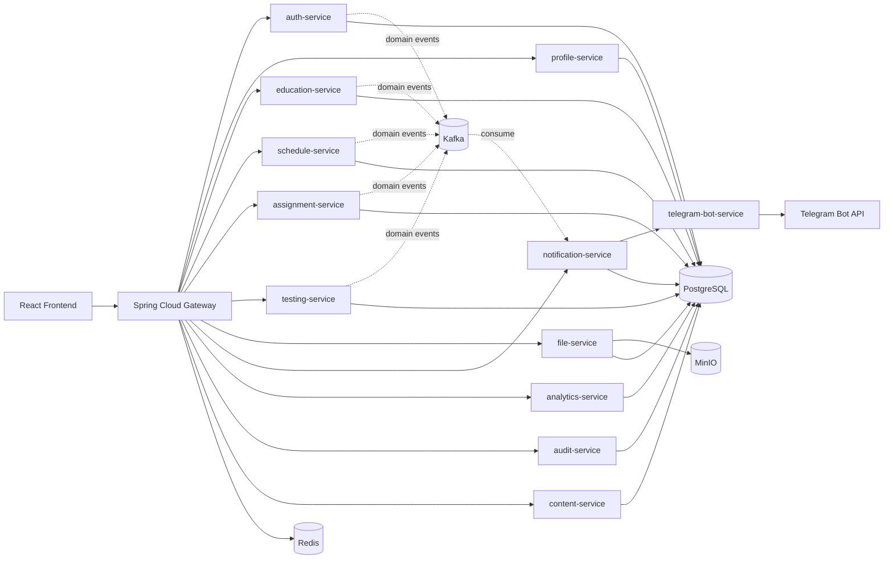
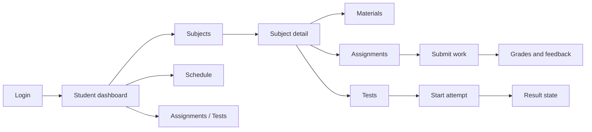
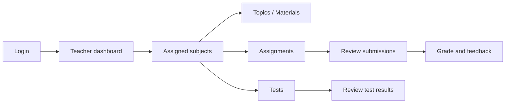
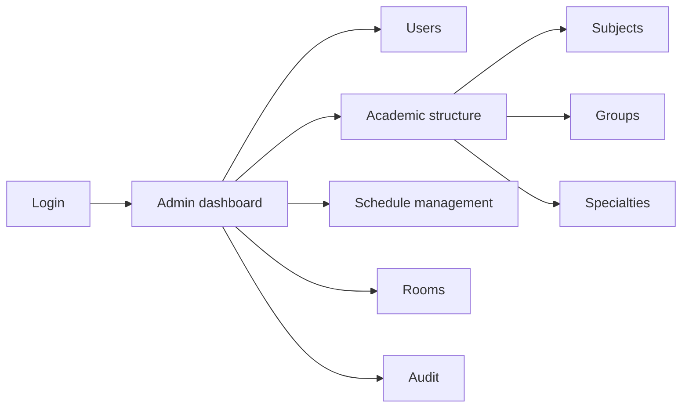
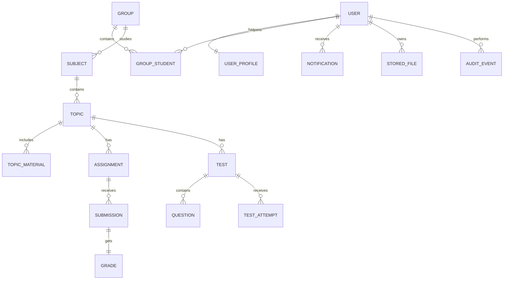
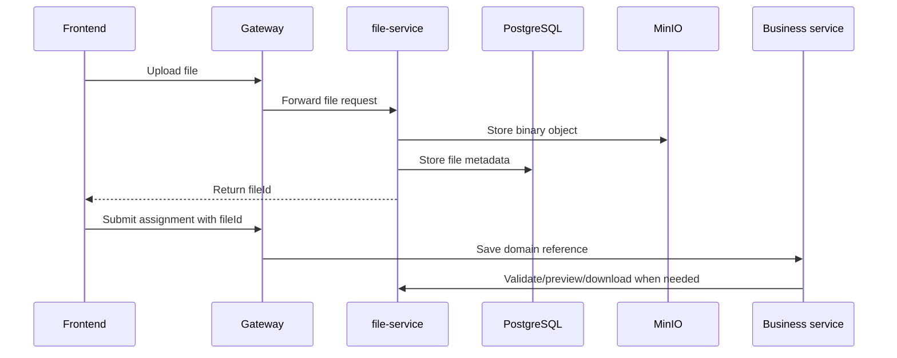
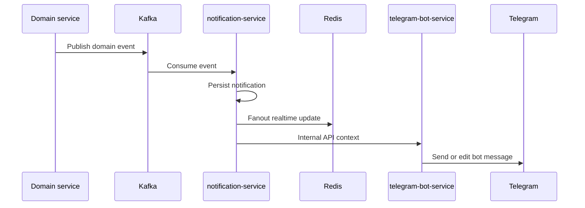

<div align="center">

# Studium

**A role-based, microservice Learning Management System for modern academic workflows.**

Studium is a Java 21 + Spring Boot LMS with a React and TypeScript frontend.  
It brings students, teachers, administrators, files, schedules, assignments, tests, notifications, audit trails, and Telegram integration into one product-grade academic platform.

<br />


</div>

---

## Table of contents

- [Overview](#overview)
- [What Studium solves](#what-studium-solves)
- [Feature matrix](#feature-matrix)
- [Architecture](#architecture)
- [Runtime services](#runtime-services)
- [Technology stack](#technology-stack)
- [Repository structure](#repository-structure)
- [Quick start](#quick-start)
- [Demo accounts](#demo-accounts)
- [Local development](#local-development)
- [Validation and quality checks](#validation-and-quality-checks)
- [Environment configuration](#environment-configuration)
- [Role-based workflows](#role-based-workflows)
- [Core domain model](#core-domain-model)
- [Files, previews and storage](#files-previews-and-storage)
- [Notifications and Telegram](#notifications-and-telegram)
- [Security model](#security-model)
- [Known limitations](#known-limitations)
- [Documentation](#documentation)
- [Roadmap](#roadmap)

---

## Overview

**Studium** is a full-stack LMS platform designed around real academic roles and workflows.

Instead of treating an LMS as a static file storage or a simple electronic journal, Studium models the full academic process:

- users and profiles;
- students, teachers, admins and owners;
- groups, subgroups, subjects, topics and materials;
- schedule templates and academic timetable views;
- assignments, submissions and grades;
- tests, questions, attempts and result review;
- file upload, download and preview;
- notifications and Telegram linking;
- analytics and audit trails.

The backend is split into domain-oriented Spring Boot services and exposed through a single public gateway. The frontend is a role-aware React SPA with separate student, teacher and administrator workspaces.

---

## What Studium solves

Most small academic systems grow into disconnected tools: one place for files, another for deadlines, another for grades, another for announcements, and a separate document for schedule updates.

Studium consolidates those workflows into one platform:

| Problem | Studium approach |
|---|---|
| Scattered academic data | One structured LMS domain across subjects, groups, tasks and tests |
| Role confusion | Separate Student, Teacher, Admin and Owner workflows |
| Manual deadline tracking | Dashboard cards, assignment/test availability and notification events |
| File chaos | Dedicated `file-service`, metadata storage, MinIO object storage and preview support |
| Weak auditability | Dedicated `audit-service` for entity and security events |
| Hard-to-scale backend | Microservice decomposition with gateway, REST and Kafka |
| Poor UX for daily work | Role-aware sidebar, dashboards, cards, tables, filters and contextual pages |

---

## Feature matrix

### Student workspace

| Area | Capabilities |
|---|---|
| Dashboard | Courses, today's schedule, nearest deadlines, latest grades, unread notifications |
| Subjects | Available courses, subject details, topics, assignments, tests, materials |
| Assignments | Assignment list, details, deadlines, criteria, file-based submissions |
| Tests | Available tests, attempt limits, availability windows, result state |
| Grades | Grade overview, feedback and risk/status indicators |
| Schedule | Personal schedule, group schedule and schedule hub |
| Group | Group profile, subgroup, specialty, roster |
| Notifications | Read/unread state, delete actions, deadline and system messages |
| Profile | Display name, locale, timezone, avatar and Telegram connection |

### Teacher workspace

| Area | Capabilities |
|---|---|
| Dashboard | Assigned subjects, today lessons, review queues, risk groups, active assignments/tests |
| Subjects | Subject overview, topics, assignments, tests, materials, students, analytics |
| Assignments | Create and manage assignments from course context |
| Review | Submission preview, download, grade entry and feedback |
| Tests | Create/manage tests, questions, availability and results |
| Groups | Read-oriented group rosters and academic context |
| Schedule | Teacher schedule views |
| Notifications/Profile | Same platform notification and profile flow |

### Admin and Owner workspace

| Area | Capabilities |
|---|---|
| Dashboard | Platform overview, student/teacher/group counters, audit highlights |
| Academic structure | Subjects, groups, specialties, streams, curriculum plans |
| Schedule management | Group, teacher and room schedule views and management routes |
| Rooms | Room capacity, building/floor data, active/archive state |
| Users | User list, role distribution and administrative user actions |
| Audit | Queryable audit events with actor, entity, action and source service |
| Analytics | Dashboard-oriented platform insights |

---

## Architecture

Studium uses a microservice architecture with a single public gateway.



### Architecture rules

- Public API traffic enters through `gateway`.
- Backend services own their domain and persistence model.
- Cross-service communication is REST for direct flows and Kafka for async events.
- Shared internal endpoints are protected by internal service secrets.
- Frontend route visibility is role-aware, but security is enforced server-side.
- File binaries are stored outside the relational database in MinIO.
- Notifications are persisted and can be fanned out through realtime channels and Telegram.

---

## Runtime services

| Service | Responsibility |
|---|---|
| `gateway` | Public API entrypoint, route policy, role checks, BFF-style aggregation |
| `auth-service` | Identity, login, registration, JWT, roles, MFA, user ban/admin flows |
| `profile-service` | User profiles, display names, locale/timezone, avatar references |
| `education-service` | Groups, subjects, topics, specialties, streams, curriculum and rosters |
| `schedule-service` | Schedule templates, lesson slots, rooms, overrides, schedule read/export |
| `assignment-service` | Assignments, submissions, grades, attachment policy and review flow |
| `testing-service` | Tests, questions, answers, attempts, results and teacher review |
| `file-service` | File metadata, MinIO integration, upload, download and preview |
| `notification-service` | Notification center, unread counters, realtime fanout, Telegram links |
| `telegram-bot-service` | Telegram long-polling client and bot UX over internal APIs |
| `analytics-service` | Dashboard and analytics-oriented projections |
| `audit-service` | Audit event persistence and query API |
| `content-service` | Content-oriented LMS module surface |
| `frontend` | React SPA for Student, Teacher, Admin and Owner workflows |

---

## Technology stack

### Backend

| Technology | Usage |
|---|---|
| Java 21 | Main backend language |
| Spring Boot 3.5 | Service runtime and REST APIs |
| Spring Security | Authentication and authorization |
| Spring Cloud Gateway | Public gateway and route policy |
| Spring Data JPA | Persistence layer |
| Flyway | Database migrations |
| Gradle | Multi-module backend build |
| Lombok | Reducing Java boilerplate |

### Frontend

| Technology | Usage |
|---|---|
| React 19 | UI component model |
| TypeScript | Static typing |
| Vite | Fast development and build tool |
| React Router | Client-side routing |
| React Query | API data fetching and cache management |
| Axios | HTTP client |
| Zod | Runtime validation |
| TailwindCSS | UI styling system |
| Vitest | Frontend tests |

### Infrastructure

| Component | Usage |
|---|---|
| PostgreSQL | Main relational database |
| Redis | Cache and realtime fanout support |
| Kafka | Domain events and async processing |
| MinIO | Object storage for uploaded files |
| Docker Compose | Local orchestration |
| Bash scripts | Local stack automation |

---

## Repository structure

```text
Studium/
├── apps/
│   ├── frontend/
│   ├── gateway/
│   ├── auth-service/
│   ├── profile-service/
│   ├── education-service/
│   ├── schedule-service/
│   ├── assignment-service/
│   ├── testing-service/
│   ├── file-service/
│   ├── notification-service/
│   ├── telegram-bot-service/
│   ├── analytics-service/
│   ├── audit-service/
│   └── content-service/
├── libs/
│   ├── security/
│   ├── web-contracts/
│   └── event-contracts/
├── infra/
│   ├── scripts/
│   ├── keys/
│   └── docker/
├── docs/
│   ├── architecture.md
│   ├── backend-services.md
│   ├── frontend-flows.md
│   ├── roles-permissions.md
│   ├── notifications.md
│   ├── telegram-bot.md
│   ├── environment.md
│   └── local-development.md
└── README.md
```

---

## Quick start

### Prerequisites

- Docker and Docker Compose
- Java 21
- Node.js
- Bash-compatible shell

### Start the local stack

```bash
cp .env.example .env
./infra/scripts/local/start-local.sh
```

The startup script handles the core local setup flow:

- bootstraps `.env` when missing;
- ensures JWT keypair under `infra/keys`;
- builds or rebuilds changed services;
- starts the Docker Compose stack.

### Seed deterministic demo data

```bash
./infra/scripts/local/seed-demo.sh
```

### Open the application

| Target | URL |
|---|---|
| Frontend | `http://localhost:3000` |
| Gateway API | `http://localhost:8080` |

---

## Demo accounts

The demo seed script creates role-specific accounts with the password:

```text
DemoPass123!
```

| Username | Role |
|---|---|
| `admin.demo` | Admin |
| `teacher.alpha` | Teacher |
| `teacher.beta` | Teacher |
| `student.one` | Student |
| `student.two` | Student |
| `student.three` | Student |
| `student.four` | Student |
| `student.five` | Student |

Owner bootstrap is controlled by environment variables:

| Variable | Default |
|---|---|
| `AUTH_OWNER_USERNAME` | `owner` |
| `AUTH_OWNER_PASSWORD` | `ChangeMe123!` |

---

## Local development

### Main stack commands

```bash
# Start or update full local stack
./infra/scripts/local/start-local.sh

# Restart only frontend path
./infra/scripts/local/start-local.sh --frontend-only

# Force full rebuild
./infra/scripts/local/start-local.sh --rebuild

# Destructive local reset
./infra/scripts/local/start-local.sh --fresh
```

### Default local endpoints

| Service | URL |
|---|---|
| Frontend | `http://localhost:3000` |
| Gateway | `http://localhost:8080` |
| Auth | `http://localhost:8081` |
| Profile | `http://localhost:8082` |
| File | `http://localhost:8083` |
| Notification | `http://localhost:8084` |
| Education | `http://localhost:8085` |
| Assignment | `http://localhost:8086` |
| Testing | `http://localhost:8087` |
| Schedule | `http://localhost:8088` |
| Analytics | `http://localhost:8089` |
| Audit | `http://localhost:8090` |
| Content | `http://localhost:8091` |
| Telegram bot service | `http://localhost:8092` |

### Local infrastructure

| Component | Default port |
|---|---:|
| PostgreSQL | `5432` |
| PgBouncer | `6432` |
| Redis | `6379` |
| Kafka | `29092` |
| MinIO | `9000` |
| MinIO Console | `9001` |

---

## Validation and quality checks

### Frontend

```bash
cd apps/frontend

npm install
npm run typecheck
npm run lint
npm test -- --run
```

### Backend build examples

```bash
./gradlew :apps:gateway:bootJar
./gradlew :apps:notification-service:bootJar
./gradlew :apps:telegram-bot-service:bootJar
```

### Verification baseline

The project also uses API-level verification through the gateway.  
The current documented backend baseline includes **149 successful API checks** with **0 failures**.

---

## Environment configuration

Primary local configuration is stored in:

```text
.env.example
```

High-impact configuration groups:

| Group | Examples |
|---|---|
| Service ports | Gateway, frontend and downstream service URLs |
| Database | PostgreSQL host, port, user, password, database, service schemas |
| Security | JWT issuer/audience/keys, internal service token |
| Telegram | `TELEGRAM_*`, bot username, bot token, notification service URL |
| Files | MinIO endpoint, bucket, access keys |
| Frontend | Public gateway URL and application base URL |

For the full mapping, see [`docs/environment.md`](docs/environment.md).

---

## Role-based workflows

### Student flow



### Teacher flow



### Admin flow



---

## Core domain model



Main domain entities include:

| Domain | Entities |
|---|---|
| Identity | `User`, `Role`, `UserBan`, MFA methods |
| Profile | `UserProfile` |
| Education | `Group`, `GroupStudent`, `Subject`, `Topic`, `TopicMaterial`, `Specialty`, `Stream`, `CurriculumPlan` |
| Schedule | `ScheduleTemplate`, `LessonSlot`, `Room`, `Semester`, overrides |
| Assignments | `Assignment`, `Submission`, `Grade`, submission comments and attachments |
| Testing | `Test`, `Question`, `Answer`, `TestAttempt`, `TestResult` |
| Files | `StoredFile` |
| Notifications | `Notification`, `TelegramLink`, `TelegramConnectToken` |
| Audit | `AuditEvent` |

---

## Files, previews and storage

Studium uses a dedicated file pipeline.



The file service handles:

- file metadata;
- object keys;
- ownership;
- access policy;
- soft delete state;
- download;
- preview for supported file types.

---

## Notifications and Telegram

Studium supports both in-app notifications and Telegram linking.



Notification capabilities:

- unread counters;
- notification dropdown;
- notification center;
- mark as read;
- mark all as read;
- delete notification;
- event-derived notifications;
- Telegram connect token flow;
- Telegram preferences for assignments, tests, grades, schedule, materials and system events.

Telegram runtime notes:

- the bot service uses long polling;
- webhook mode is not used;
- invalid or missing bot token disables polling safely instead of crashing the service;
- public Telegram URL buttons are intentionally suppressed for localhost/internal URLs.

---

## Security model

Studium uses layered security.

| Layer | Responsibility |
|---|---|
| Frontend | Role-aware navigation and route guards |
| Gateway | Public route policy and access control |
| Backend services | Domain-level authorization and validation |
| JWT | User identity and role propagation |
| Internal secret headers | Protected service-to-service APIs |
| Audit service | Traceability for critical domain actions |
| Environment config | Secrets and runtime configuration isolation |

Core principles:

- do not trust frontend-only restrictions;
- enforce permissions at the gateway and service level;
- avoid direct cross-service database reads in business flows;
- keep secrets out of source code;
- use test/demo accounts for local development;
- store files in object storage, not directly inside business tables.

---

## Known limitations

Current documented limitations:

- Telegram schedule screen currently uses a placeholder internal schedule context.
- Telegram URL buttons require public URLs; localhost/internal URLs are intentionally not rendered as bot menu buttons.
- Search endpoint is scoped to Admin/Owner usage.
- Some analytics surfaces are projection-oriented and depend on available activity data.

---

## Documentation

| Document | Purpose |
|---|---|
| [`docs/architecture.md`](docs/architecture.md) | System architecture, service boundaries and event flow |
| [`docs/backend-services.md`](docs/backend-services.md) | Backend service responsibilities and endpoint groups |
| [`docs/frontend-flows.md`](docs/frontend-flows.md) | Student, Teacher and Admin frontend flows |
| [`docs/roles-permissions.md`](docs/roles-permissions.md) | Role and permission matrix |
| [`docs/notifications.md`](docs/notifications.md) | Notification center and event-driven notification behavior |
| [`docs/telegram-bot.md`](docs/telegram-bot.md) | Telegram bot runtime and UX |
| [`docs/environment.md`](docs/environment.md) | Environment variable mapping |
| [`docs/local-development.md`](docs/local-development.md) | Local setup, commands and troubleshooting |

---

## Roadmap

Potential next steps:

- wire Telegram schedule context to real resolved schedule data;
- expand analytics projections;
- add richer test question types;
- improve assignment rubric support;
- add export flows for gradebooks and reports;
- add production deployment manifests;
- add observability stack for logs, metrics and traces;
- add screenshots under `docs/assets/` and embed them in this README.

---

## Project status

Studium is an active academic LMS project with implemented local stack, role-based UI flows, backend services, demo data and verification scripts.

It is suitable for:

- diploma project demonstration;
- microservice architecture showcase;
- LMS domain modeling;
- Java/Spring Boot backend portfolio;
- React/TypeScript frontend portfolio;
- local end-to-end academic workflow testing.

---

<div align="center">